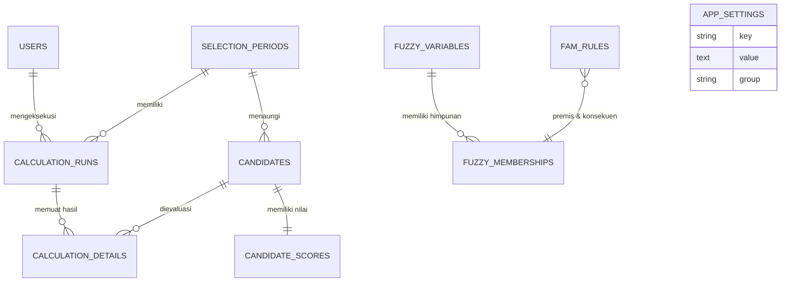

# Sistem Pendukung Keputusan (SPK) Penerimaan Santri Baru Menggunakan Metode Fuzzy Associative Memory (FAM)

[](https://laravel.com)
[](https://php.net)
[](https://tailwindcss.com)
[](https://livewire.laravel.com)
[](https://mysql.com)
[]()

Aplikasi web Sistem Pendukung Keputusan (SPK) untuk seleksi Penerimaan Santri Baru (PSB) pada **Pesantren Ell Firdaus**, Kabupaten Labuhanbatu Selatan, Sumatera Utara. Sistem mengimplementasikan algoritma kecerdasan buatan berbasis logika fuzzy yaitu **Fuzzy Associative Memory (FAM)** yang dikembangkan oleh Bart Kosko (1992).

---

## Daftar Isi
1. [Latar Belakang & Tujuan](#latar-belakang--tujuan)
2. [Metodologi Fuzzy Associative Memory (FAM)](#metodologi-fuzzy-associative-memory-fam)
3. [Fitur Utama Sistem](#fitur-utama-sistem)
4. [Teknologi yang Digunakan](#teknologi-yang-digunakan)
5. [Prasyarat Sistem](#prasyarat-sistem)
6. [Panduan Instalasi](#panduan-instalasi)
7. [Akun Pengguna Bawaan (Default Credentials)](#akun-pengguna-bawaan-default-credentials)
8. [Pengujian Otomatis (Automated Testing)](#pengujian-otomatis-automated-testing)
9. [Struktur Database & Alur Data](#struktur-database--alur-data)
10. [Dokumentasi Audit Perhitungan Matematis](#dokumentasi-audit-perhitungan-matematis)
11. [Lisensi & Hak Cipta](#lisensi--hak-cipta)

---

## Latar Belakang & Tujuan

Penerimaan santri baru di pondok pesantren melibatkan pertimbangan multi-kriteria yang bersifat kuantitatif (nilai rapor akademik) dan kualitatif (bacaan Al-Qur'an, hafalan tahfidz, serta motivasi mondok dalam wawancara). Pendekatan seleksi konvensional sering kali menghadapi kendala subjektivitas penguji dan kesulitan dalam menangani ketidakpastian (*fuzziness*) pada batas ambang kelulusan.

Sistem ini dibangun untuk:
- Mengotomatisasi pemrosesan keputusan seleksi secara objektif, transparan, dan dapat dipertanggungjawabkan secara akademik.
- Menerapkan **Fuzzy Associative Memory (FAM)** untuk memetakan asosiasi jamak antara 4 kriteria input ke dalam ruang keputusan output kelulusan.
- Menyediakan lembar audit matematis transparan (*step-by-step trace*) mulai dari derajat keanggotaan, firing strength aturan, agregasi implikasi, hingga defuzzifikasi Centroid.
- Menyediakan output Surat Keputusan (SK) dan Berita Acara Kelulusan yang siap cetak standar dokumen A4.

---

## Metodologi Fuzzy Associative Memory (FAM)

Metode FAM merupakan model jaringan asosiatif fuzzy yang memetakan himpunan fuzzy input ke himpunan fuzzy output melalui matriks relasi kausalitas (Kosko, 1992).

### 1. Kriteria Input & Semesta Pembicaraan
| Simbol | Kriteria Penilaian | Semesta Pembicaraan | Himpunan Fuzzy | Bentuk Kurva |
| :---: | :--- | :---: | :---: | :--- |
| **$K_1$** | Nilai Akademik / Rapor Pokok | $[0, 100]$ | Rendah, Sedang, Tinggi | Bahu Kiri, Segitiga, Bahu Kanan |
| **$K_2$** | Tes Baca Tulis Al-Qur'an (BTQ) | $[0, 100]$ | Rendah, Sedang, Tinggi | Bahu Kiri, Segitiga, Bahu Kanan |
| **$K_3$** | Tes Hafalan Al-Qur'an (Tahfidz) | $[0, 100]$ | Rendah, Sedang, Tinggi | Bahu Kiri, Segitiga, Bahu Kanan |
| **$K_4$** | Tes Wawancara & Kepribadian | $[0, 100]$ | Rendah, Sedang, Tinggi | Bahu Kiri, Segitiga, Bahu Kanan |

### 2. Kriteria Output (Keputusan Kelayakan)
- **Semesta Pembicaraan**: $[0, 100]$ (atau skala normalisasi $[0.0, 1.0]$)
- **Himpunan Fuzzy Output**:
  - *Tidak Diterima* (Bahu Kiri: $[0, 0, 50, 65]$)
  - *Dipertimbangkan* (Segitiga / Trapesium: $[55, 70, 80]$)
  - *Diterima* (Bahu Kanan: $[75, 85, 100, 100]$)

### 3. Tahapan Algoritma FAM
1. **Fuzzifikasi**:
   Mengonversi nilai riil mentah (0–100) masing-masing kriteria menjadi derajat keanggotaan $\mu(x) \in [0, 1]$.
2. **Aktivasi Aturan Asosiasi FAM (Rule Firing)**:
   Mengevaluasi basis aturan menggunakan operator minimum (intersection):
   $$\alpha_k = \min\left(\mu_{K_1}^{(k)}, \mu_{K_2}^{(k)}, \mu_{K_3}^{(k)}, \mu_{K_4}^{(k)}\right)$$
3. **Agregasi Implikasi Fuzzy**:
   Menggabungkan konsekuen aturan aktif menggunakan operator maksimum (union):
   $$\mu_{\text{agregat}}(z) = \max_k \left( \min\left(\alpha_k, \mu_{\text{output}}^{(k)}(z)\right) \right)$$
4. **Defuzzifikasi Centroid / Center of Area (COA)**:
   Menghitung titik berat dari kurva agregasi fuzzy untuk menghasilkan skor riil tunggal:
   $$Z^* = \frac{\sum_{i=1}^{n} z_i \cdot \mu(z_i)}{\sum_{i=1}^{n} \mu(z_i)}$$
5. **Mekanisme Hierarki Pemutus Seri (*Tie-Breaker Hierarchy*)**:
   Jika dua santri memperoleh skor defuzzifikasi identik, sistem menerapkan hierarki prioritas pesantren:
   $$\text{Tahfidz } (K_3) \longrightarrow \text{BTQ } (K_2) \longrightarrow \text{Akademik } (K_1) \longrightarrow \text{Wawancara } (K_4)$$

---

## Fitur Utama Sistem

- **Dashboard Operasional**: Menampilkan ringkasan gelombang aktif, total pendaftar, status kelengkapan nilai, dan kandidat berperingkat teratas.
- **Manajemen Periode / Gelombang Seleksi**: Pengaturan kuota pendaftar, rentang tanggal buka/tutup, passing grade kelulusan, dan status aktif.
- **Manajemen Calon Santri**: Pencatatan biodata santri, penomoran registrasi unik otomatis, pencarian, dan penyaringan berdasarkan jenis kelamin dan gelombang.
- **Input & Validasi Nilai 4 Kriteria**: Validasi skala ketat 0.00–100.00, pelacakan status kelengkapan 4 kriteria, serta penandaan otomatis *outdated calculation* jika nilai diubah pasca-perhitungan.
- **Konfigurasi Parameter Fuzzy & Rule Base**:
  - Penyesuaian batas parameter kurva ($a, b, c, d$) himpunan fuzzy.
  - Penambahan, aktivasi/non-aktifkan, dan penghapusan aturan asosiasi FAM.
- **Engine Komputasi FAM & Jejak Audit**:
  - Eksekusi komputasi seleksi satu gelombang sekaligus.
  - Lembar audit transparansi (*Trace Matrix*) per santri dengan formula matematis LaTeX.
- **Peringkat & Penetapan Kelulusan**: Perankingan otomatis berdasarkan skor defuzzifikasi COA dan kuota gelombang.
- **Laporan & Cetak Surat Keputusan (SK)**: Format cetak resmi standar A4 lengkap dengan Kop Surat resmi pesantren dan kolom tanda tangan pengesahan.
- **Pengaturan Website & Identitas Lembaga**:
  - Pengubahan nama pesantren, tagline daerah, alamat, nomor telepon/WA, email, dan website.
  - Pengunggahan logo resmi dan favicon tab browser kustom.
  - Simulasi kop surat dan data pejabat penandatangan (Pimpinan Pesantren & Ketua Panitia PSB).
- **Role-Based Access Control (RBAC)**:
  - **Administrator / Panitia**: Hak akses penuh (CRUD, kelola nilai, eksekusi FAM, dan pengaturan sistem).
  - **Pimpinan Pesantren**: Akses baca (*read-only*) untuk pemantauan hasil seleksi, peninjauan trace audit, dan cetak laporan SK.

---

## Teknologi yang Digunakan

- **Framework**: Laravel 11.x
- **Bahasa Pemrograman**: PHP 8.2+
- **Database**: MySQL 8.0
- **Frontend / Styling**: Tailwind CSS v3.x (Clean Modern Enterprise Aesthetics)
- **Komponen Reaktif**: Livewire 3.x + Livewire Volt (Laravel Breeze)
- **JavaScript UI**: Alpine.js
- **Build Tool**: Vite v5.x
- **Testing Framework**: PHPUnit & Pest PHP

---

## Prasyarat Sistem

Sebelum menginstal, pastikan komputer/server Anda telah terpasang:
- **PHP** versi 8.2 atau lebih tinggi (ekstensi: `pdo_mysql`, `mbstring`, `openssl`, `tokenizer`, `xml`, `ctype`, `json`, `bcmath`, `fileinfo`).
- **Composer** versi 2.x
- **Node.js** versi 18+ dan **NPM**
- **MySQL** / MariaDB Server

---

## Panduan Instalasi

### 1. Kloning Repositori
```bash
git clone https://github.com/Mukti102/fuzzy-associative.git
cd fuzzy-associative
```

### 2. Pasang Dependensi Backend (Composer)
```bash
composer install
```

### 3. Pasang Dependensi Frontend (NPM)
```bash
npm install
```

### 4. Konfigurasi Lingkungan (`.env`)
Salin file template `.env.example` menjadi `.env`:
```bash
cp .env.example .env
```
Generate application key:
```bash
php artisan key:generate
```

Sesuaikan konfigurasi database pada file `.env`:
```env
DB_CONNECTION=mysql
DB_HOST=127.0.0.1
DB_PORT=3306
DB_DATABASE=fuzzy
DB_USERNAME=root
DB_PASSWORD=
```

### 5. Jalankan Migrasi Database & Seeder
Perintah berikut akan membuat seluruh tabel, mengisi data awal pengguna, parameter fuzzy, aturan FAM Kosko, serta data gelombang seleksi:
```bash
php artisan migrate --seed
```

### 6. Kompilasi Aset Frontend
Untuk mode produksi:
```bash
npm run build
```
Atau untuk mode pengembangan (*hot-reload*):
```bash
npm run dev
```

### 7. Jalankan Server Aplikasi
```bash
php artisan serve
```
Aplikasi dapat diakses melalui browser pada alamat: **`http://127.0.0.1:8000`**

---

## Akun Pengguna Bawaan (Default Credentials)

Tersedia dua akun bawaan hasil *seeding* untuk pengujian:

| Role / Peran | Alamat Email | Kata Sandi | Deskripsi Hak Akses |
| :--- | :--- | :--- | :--- |
| **Administrator / Panitia** | `admin@ellfirdaus.ac.id` | `password` | Akses penuh CRUD, input nilai, jalankan FAM, pengaturan lembaga. |
| **Pimpinan Pesantren** | `pimpinan@ellfirdaus.ac.id` | `password` | Akses monitoring hasil seleksi, lembar trace matematika, cetak SK. |

---

## Pengujian Otomatis (Automated Testing)

Aplikasi dilengkapi dengan rangkaian pengujian fitur (*feature tests*) dan pengujian unit (*unit tests*) untuk menjamin keandalan logika komputasi FAM, otorisasi RBAC, validasi data, dan pengaturan sistem.

Jalankan pengujian menggunakan PHP Artisan:
```bash
php artisan test
```

### Hasil Eksekusi Uji Terakhir
```
Tests:    46 passed (201 assertions)
Duration: ~11.00s
Status:   100% GREEN
```

Cakupan pengujian meliputi:
- `AuthenticationTest`: Render halaman login, otentikasi sukses, proteksi password salah, dan logout.
- `DashboardAndNavigationTest`: Pengalihan tamu, RBAC Admin vs Pimpinan, penanganan user nonaktif, dan metrik dashboard.
- `FAMCalculationEngineTest`: Penolakan nilai belum lengkap, komputasi inferensi FAM Kosko, hierarki pemutus seri (*tie-breaker*), dan hak akses pimpinan.
- `PeriodCandidateScoreManagementTest`: CRUD periode seleksi, pencegahan hapus periode berisi santri, pencegahan nomor registrasi duplikat, dan penandaan *outdated score*.
- `SettingsManagementTest`: Akses view pimpinan, penolakan update pimpinan, update profil instansi oleh admin, serta pengunggahan & penghapusan logo dan favicon.

---

## Struktur Database & Alur Data



---

## Dokumentasi Audit Perhitungan Matematis

Setiap eksekusi komputasi seleksi santri menyimpan riwayat *immutable snapshot* parameter fuzzy pada saat eksekusi berlangsung. Administrator dan Pimpinan dapat memeriksa rincian perhitungan setiap calon santri melalui menu **Hasil Seleksi FAM &rarr; Detail &rarr; Trace Perhitungan**:
1. **Derajat Fuzzifikasi**: Nilai $\mu(x)$ untuk tiap kriteria ($K_1, K_2, K_3, K_4$).
2. **Aturan FAM Aktif**: Daftar aturan dengan firing strength $\alpha_k > 0$.
3. **Grafik Agregasi**: Kurva gabungan implikasi menggunakan operator Max.
4. **Perhitungan Defuzzifikasi COA**: Tabel integral numerik $z_i$, $\mu(z_i)$, dan titik berat centroid $Z^*$.

---

## Lisensi & Hak Cipta

Proyek ini dikembangkan untuk keperluan akademik dan penelitian skripsi pada program studi Teknik Informatika / Sistem Informasi, bekerja sama dengan **Pesantren Ell Firdaus Labusel**. 

Hak Cipta &copy; 2026 **Pesantren Ell Firdaus Labusel**. Seluruh kode sumber dirilis di bawah lisensi [MIT License](LICENSE).
