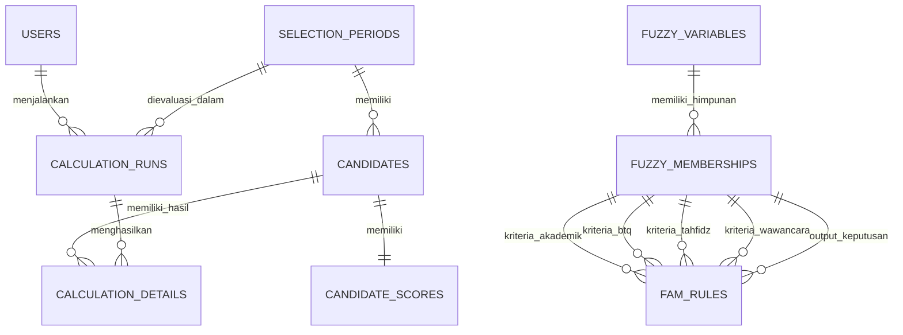

# DOKUMENTASI PERANCANGAN DATABASE (DATABASE DESIGN)
## Sistem Pendukung Keputusan (SPK) Penerimaan Santri Baru Menggunakan Metode FAM - Pesantren Ell Firdaus Labusel

---

### 1. Entitas & Rasionalisasi Desain
Database dirancang menggunakan prinsip normalisasi (3NF) dengan tetap mempertahankan fleksibilitas dan integritas riwayat seleksi (audit trail).

---

### 2. Spesifikasi Skema Tabel

#### 2.1 `users`
Tabel pengguna terintegrasi dengan Laravel Breeze dengan tambahan kontrol hak akses (RBAC):
- `id` (BIGINT, PK, Auto Increment)
- `name` (VARCHAR 255)
- `email` (VARCHAR 255, Unique)
- `password` (VARCHAR 255)
- `role` (ENUM: `'admin'`, `'pimpinan'`, Default: `'admin'`)
- `phone` (VARCHAR 20, Nullable)
- `is_active` (BOOLEAN, Default: `true`)
- `remember_token` (VARCHAR 100, Nullable)
- `email_verified_at` (TIMESTAMP, Nullable)
- `created_at`, `updated_at` (TIMESTAMP)

#### 2.2 `selection_periods`
Periode pendaftaran/seleksi santri baru MA:
- `id` (BIGINT, PK, Auto Increment)
- `name` (VARCHAR 255) — Contoh: "Seleksi Santri Baru MA TA 2026/2027"
- `academic_year` (VARCHAR 20) — Contoh: "2026/2027"
- `start_date` (DATE)
- `end_date` (DATE)
- `is_active` (BOOLEAN, Default: `false`)
- `passing_grade` (DECIMAL 8,4, Nullable) — Nilai ambang batas akhir kelulusan FAM
- `quota` (INT, Nullable) — Kuota daya tampung jika ada
- `description` (TEXT, Nullable)
- `created_at`, `updated_at` (TIMESTAMP)

#### 2.3 `candidates`
Data master calon santri per periode:
- `id` (BIGINT, PK, Auto Increment)
- `selection_period_id` (BIGINT, FK ke `selection_periods.id`, onDelete RESTRICT)
- `registration_number` (VARCHAR 50) — Nomor pendaftaran/tes
- `name` (VARCHAR 255)
- `gender` (ENUM: `'L'`, `'P'`)
- `birth_place` (VARCHAR 100, Nullable)
- `birth_date` (DATE, Nullable)
- `school_origin` (VARCHAR 255, Nullable)
- `address` (TEXT, Nullable)
- `phone` (VARCHAR 30, Nullable)
- `created_at`, `updated_at` (TIMESTAMP)
- *Constraint*: `UNIQUE(selection_period_id, registration_number)`

#### 2.4 `candidate_scores`
Nilai mentah 4 kriteria seleksi calon santri:
- `id` (BIGINT, PK, Auto Increment)
- `candidate_id` (BIGINT, FK ke `candidates.id`, onDelete CASCADE, UNIQUE)
- `academic_score` (DECIMAL 8,2, Nullable) — Nilai rapor/akademik (rentang 0 - 100)
- `btq_score` (DECIMAL 8,2, Nullable) — Nilai tes Baca Tulis Al-Qur'an (rentang 0 - 100)
- `tahfidz_score` (DECIMAL 8,2, Nullable) — Nilai hafalan Al-Qur'an (rentang 0 - 100)
- `interview_score` (DECIMAL 8,2, Nullable) — Nilai wawancara/kepribadian (rentang 0 - 100)
- `is_complete` (BOOLEAN, Default: `false`) — Status kelengkapan seluruh 4 nilai
- `needs_recalculation` (BOOLEAN, Default: `false`) — Penanda nilai telah berubah dan wajib dihitung ulang
- `notes` (TEXT, Nullable)
- `created_at`, `updated_at` (TIMESTAMP)

#### 2.5 `fuzzy_variables`
Definisi variabel input dan output:
- `id` (BIGINT, PK, Auto Increment)
- `code` (VARCHAR 50, UNIQUE) — `AKADEMIK`, `BTQ`, `TAHFIDZ`, `WAWANCARA`, `OUTPUT`
- `name` (VARCHAR 100)
- `type` (ENUM: `'input'`, `'output'`)
- `min_range` (DECIMAL 8,2, Default: 0)
- `max_range` (DECIMAL 8,2, Default: 100)
- `unit` (VARCHAR 50, Nullable)
- `created_at`, `updated_at` (TIMESTAMP)

#### 2.6 `fuzzy_memberships`
Fungsi keanggotaan kurva fuzzy (Rendah, Sedang, Tinggi, dll):
- `id` (BIGINT, PK, Auto Increment)
- `fuzzy_variable_id` (BIGINT, FK ke `fuzzy_variables.id`, onDelete CASCADE)
- `name` (VARCHAR 50) — Contoh: "Rendah", "Sedang", "Tinggi", "Ditolak", "Diterima"
- `curve_type` (VARCHAR 30) — `'triangular'`, `'trapezoidal'`, `'shoulder_left'`, `'shoulder_right'`
- `param_a` (DECIMAL 8,4)
- `param_b` (DECIMAL 8,4)
- `param_c` (DECIMAL 8,4, Nullable)
- `param_d` (DECIMAL 8,4, Nullable)
- `created_at`, `updated_at` (TIMESTAMP)

#### 2.7 `fam_rules`
Tabel aturan asosiasi Fuzzy Associative Memory:
- `id` (BIGINT, PK, Auto Increment)
- `code` (VARCHAR 20) — Contoh: "R1", "R2", ...
- `academic_membership_id` (BIGINT, FK ke `fuzzy_memberships.id`)
- `btq_membership_id` (BIGINT, FK ke `fuzzy_memberships.id`)
- `tahfidz_membership_id` (BIGINT, FK ke `fuzzy_memberships.id`)
- `interview_membership_id` (BIGINT, FK ke `fuzzy_memberships.id`)
- `output_membership_id` (BIGINT, FK ke `fuzzy_memberships.id`)
- `weight` (DECIMAL 4,2, Default: 1.00)
- `is_active` (BOOLEAN, Default: `true`)
- `created_at`, `updated_at` (TIMESTAMP)

#### 2.8 `calculation_runs`
Header sesi eksekusi perhitungan seleksi FAM:
- `id` (BIGINT, PK, Auto Increment)
- `selection_period_id` (BIGINT, FK ke `selection_periods.id`)
- `run_by_user_id` (BIGINT, FK ke `users.id`)
- `run_at` (DATETIME)
- `encoding_method` (VARCHAR 50) — `'correlation-minimum'` / `'correlation-product'`
- `composition_method` (VARCHAR 50) — `'max-min'` / `'max-product'`
- `defuzzification_method` (VARCHAR 50) — `'weighted-average'` / `'winner-take-all'` / `'centroid'`
- `config_snapshot` (JSON, Nullable) — Snapshot parameter fuzzy & passing grade saat kalkulasi
- `total_candidates` (INT, Default: 0)
- `passed_candidates` (INT, Default: 0)
- `failed_candidates` (INT, Default: 0)
- `created_at`, `updated_at` (TIMESTAMP)

#### 2.9 `calculation_details`
Detail komputasi matematis per santri (audit trail):
- `id` (BIGINT, PK, Auto Increment)
- `calculation_run_id` (BIGINT, FK ke `calculation_runs.id`, onDelete CASCADE)
- `candidate_id` (BIGINT, FK ke `candidates.id`)
- `fuzzification_data` (JSON, Nullable) — Derajat keanggotaan ($\mu$) masing-masing kriteria
- `activated_rules_data` (JSON, Nullable) — Aturan aktif dan firing strength ($\alpha$)
- `fam_matrix_data` (JSON, Nullable) — Representasi matriks asosiasi korelasi
- `composition_data` (JSON, Nullable) — Hasil komposisi fuzzy
- `defuzzification_data` (JSON, Nullable) — Langkah-langkah defuzzifikasi
- `final_score` (DECIMAL 8,4) — Nilai akhir FAM
- `decision` (VARCHAR 50) — `'DITERIMA'` / `'TIDAK DITERIMA'`
- `rank` (INT, Nullable) — Peringkat seleksi
- `is_outdated` (BOOLEAN, Default: `false`) — Penanda hasil tidak mutakhir karena nilai calon santri telah diperbarui
- `created_at`, `updated_at` (TIMESTAMP)
